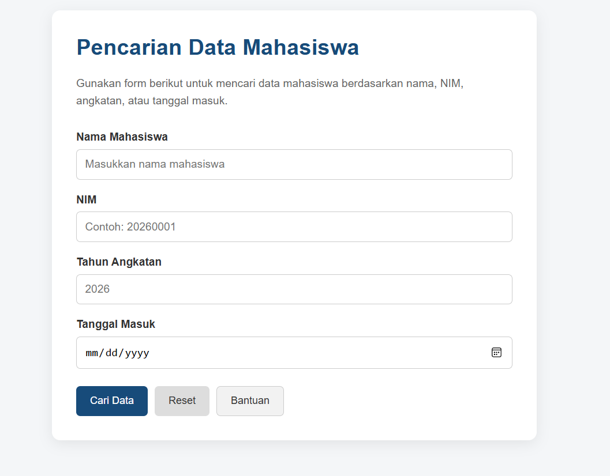
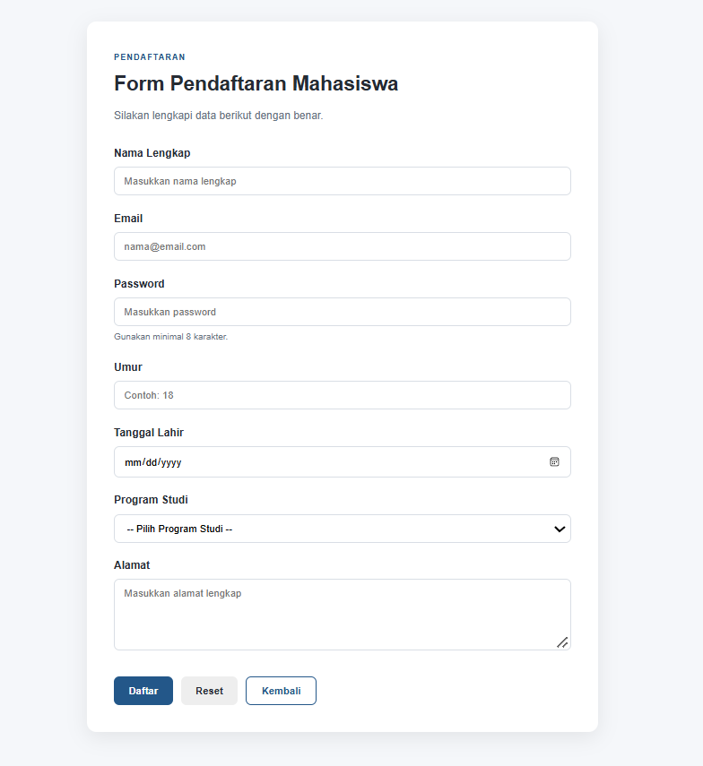

# LAPORAN PRAKTIKUM DESAIN WEB A
## Pertemuan 7: HTML Form Dasar dan Landing Page Responsif


---

## Identitas Praktikan

**Nama** : Syabita Putri Safina 
**NPM** : 4525210072 
**Mata Kuliah** :  Praktikum Desain Web A 

## 1. Tujuan Praktikum

Praktikum ini bertujuan untuk:

1. Memahami penggunaan HTML Form sebagai media untuk menerima input dari pengguna.
2. Mengetahui fungsi atribut `action` dan `method` dalam pengiriman data.
3. Menerapkan berbagai jenis input HTML, seperti `text`, `email`, `password`, `number`, dan `date`.
4. Memahami penggunaan `label`, `select`, `textarea`, dan berbagai jenis tombol.
5. Mengatur tampilan form menggunakan CSS agar lebih menarik dan terstruktur.
6. Menerapkan desain responsif menggunakan media query agar halaman dapat menyesuaikan ukuran layar perangkat.

---

## 2. Dasar Teori

### 2.1 HTML Form

HTML Form merupakan elemen yang digunakan untuk menerima data dari pengguna. Form dapat berisi berbagai kontrol input sesuai dengan kebutuhan halaman web.

Atribut utama yang digunakan dalam form:

| Atribut | Fungsi |
|---|---|
| `action` | Menentukan tujuan pengiriman data |
| `method` | Menentukan metode pengiriman data |
| `name` | Menjadi nama data ketika form dikirim |

Metode `GET` digunakan pada form pencarian mahasiswa, sedangkan metode `POST` digunakan pada form pendaftaran mahasiswa.

### 2.2 Jenis Input HTML

HTML menyediakan berbagai jenis input untuk menerima data pengguna.

| Jenis Input | Fungsi |
|---|---|
| `text` | Memasukkan teks |
| `email` | Memasukkan alamat email |
| `password` | Memasukkan kata sandi |
| `number` | Memasukkan angka |
| `date` | Memilih tanggal |
| `select` | Memilih salah satu pilihan |
| `textarea` | Memasukkan teks yang lebih panjang |

### 2.3 CSS dan Desain Responsif

CSS digunakan untuk mengatur tampilan halaman web, seperti warna, ukuran, jarak, dan posisi elemen.

Desain responsif merupakan teknik untuk membuat tampilan website menyesuaikan ukuran layar perangkat. Salah satu cara penerapannya adalah menggunakan `@media query`.

```css
@media (max-width: 600px) {
    /* Aturan CSS untuk layar kecil */
}
```

Pada praktikum ini, media query digunakan untuk menyesuaikan tampilan form ketika dibuka melalui perangkat mobile.

---

## 3. Alat dan Bahan

| Kategori | Keterangan |
|---|---|
| **Bahasa** | HTML5 dan CSS3 |
| **Text Editor** | Visual Studio Code |
| **Browser** | Google Chrome |
| **Version Control** | Git dan GitHub |

---

## 4. Struktur Proyek

Struktur proyek praktikum terdiri dari dua contoh pembuatan form dengan masing-masing file HTML dan CSS.

```text
Praktikum-Pertemuan-7/
├── Contoh 1/
│   ├── index.html
│   └── style.css
│
├── Contoh 2/
│   ├── index.html
│   └── style.css
│
└── README.md
```

Keterangan:

- `index.html`: Berisi struktur halaman web.
- `style.css`: Berisi aturan untuk mengatur tampilan halaman.
- `README.md`: Berisi dokumentasi praktikum.

---

## 5. Pembahasan dan Hasil Praktikum

### 5.1 Contoh 1: Form Pencarian Mahasiswa

Contoh pertama merupakan halaman pencarian data mahasiswa. Form ini digunakan untuk memasukkan informasi mahasiswa berdasarkan nama, NIM, tahun angkatan, dan tanggal masuk.

Form menggunakan metode `GET` dengan tujuan pengiriman menuju halaman `hasilpencarian.html`.

#### Struktur HTML

Pada bagian HTML digunakan elemen `<form>` untuk membungkus seluruh input. Setiap input memiliki label yang terhubung melalui atribut `for` dan `id`.

| Field | Jenis Input | Keterangan |
|---|---|---|
| Nama Mahasiswa | `text` | Memasukkan nama mahasiswa |
| NIM | `text` | Memasukkan nomor induk mahasiswa |
| Tahun Angkatan | `number` | Memasukkan tahun angkatan 2020–2030 |
| Tanggal Masuk | `date` | Memilih tanggal masuk mahasiswa |

Terdapat tiga tombol yang digunakan, yaitu Cari Data (`submit`), Reset (`reset`), dan Bantuan (`button`).

#### Penerapan CSS

CSS digunakan untuk mengatur tampilan form agar lebih nyaman dilihat.

| Bagian | Keterangan |
|---|---|
| Background | Abu-abu muda `#f4f6f8` |
| Warna teks | Abu-abu gelap `#333333` |
| Judul | Biru `#174b7a` |
| Kartu form | Putih dengan sudut melengkung |
| Tombol Cari Data | Biru dengan teks putih |

Class `.container` digunakan untuk mengatur posisi form di tengah halaman dengan lebar maksimal 700 piksel.

Class `.form-card` memberikan latar belakang putih, padding 35 piksel, sudut melengkung, dan efek bayangan.

#### Desain Responsif

Pada file CSS digunakan media query dengan batas maksimal 600 piksel.

```css
@media (max-width: 600px) {
    .container {
        margin: 25px auto;
    }

    .form-card {
        padding: 22px;
    }

    .button-group {
        flex-direction: column;
    }

    .btn {
        width: 100%;
    }
}
```

Ketika layar berukuran kecil, jarak form dikurangi dan tombol disusun secara vertikal. Setiap tombol juga dibuat memenuhi lebar form agar lebih mudah digunakan pada perangkat mobile.

#### Hasil Tampilan Contoh 1

**Screenshot hasil running web:**


---

### 5.2 Contoh 2: Form Pendaftaran Mahasiswa

Contoh kedua merupakan halaman pendaftaran mahasiswa yang digunakan untuk menerima data calon mahasiswa. Form ini memiliki lebih banyak jenis input dibandingkan Contoh 1.

Metode yang digunakan adalah `POST` dengan tujuan pengiriman menuju `/proses-pendaftaran`.

#### Struktur HTML

Form pendaftaran memiliki beberapa field untuk menerima informasi pengguna.

| Field | Jenis Input | Keterangan |
|---|---|---|
| Nama Lengkap | `text` | Memasukkan nama lengkap |
| Email | `email` | Memasukkan alamat email |
| Password | `password` | Memasukkan kata sandi |
| Umur | `number` | Memasukkan umur 16–80 tahun |
| Tanggal Lahir | `date` | Memilih tanggal lahir |
| Program Studi | `select` | Memilih program studi |
| Alamat | `textarea` | Memasukkan alamat lengkap |

Atribut `required` digunakan pada beberapa input agar pengguna harus mengisi data tersebut sebelum form dikirim.

Elemen `<select>` menyediakan pilihan program studi, sedangkan `<textarea>` digunakan untuk memasukkan alamat dengan area penulisan yang lebih luas.

#### Penerapan CSS

Pada Contoh 2 digunakan variabel CSS yang didefinisikan melalui `:root`. Penggunaan variabel memudahkan pengaturan warna dan tampilan secara konsisten.

| Variabel | Warna | Keterangan |
|---|---|---|
| `--primary` | `#235789` | Warna utama dan tombol Daftar |
| `--primary-dark` | `#173d61` | Warna tombol ketika hover |
| `--background` | `#f5f7fa` | Warna latar belakang halaman |
| `--surface` | `#ffffff` | Warna kartu form |
| `--border` | `#d9dee5` | Warna garis batas input |
| `--text` | `#252b33` | Warna teks utama |

Class `.registration-card` digunakan untuk membentuk kartu pendaftaran dengan padding 40 piksel, sudut melengkung 14 piksel, dan bayangan.

Selector `input`, `select`, dan `textarea` dikelompokkan agar memiliki ukuran, padding, dan tampilan yang seragam.

#### Desain Responsif

Media query diterapkan pada layar dengan lebar maksimal 600 piksel.

```css
@media (max-width: 600px) {
    .container {
        margin: 20px auto;
    }

    .registration-card {
        padding: 24px;
    }

    .form-header h1 {
        font-size: 25px;
    }

    .button-group {
        flex-direction: column;
    }

    .btn {
        width: 100%;
    }
}
```

Pada layar mobile, padding kartu dikurangi menjadi 24 piksel dan ukuran judul menjadi 25 piksel. Tombol juga disusun secara vertikal dengan lebar penuh agar lebih mudah digunakan.

#### Hasil Tampilan Contoh 2

**Screenshot hasil running web:**


---

## 6. Kesimpulan

Melalui praktikum ini, dapat dipahami penggunaan HTML Form untuk menerima input dari pengguna serta penerapan CSS untuk mengatur tampilan halaman web. Penggunaan berbagai jenis input, tombol, dan atribut form membantu membangun halaman yang sesuai dengan kebutuhan.

Selain itu, penerapan media query memungkinkan tampilan website menyesuaikan ukuran layar perangkat. Dengan demikian, halaman web dapat dibuat lebih terstruktur, menarik, dan nyaman digunakan baik pada desktop maupun mobile.
